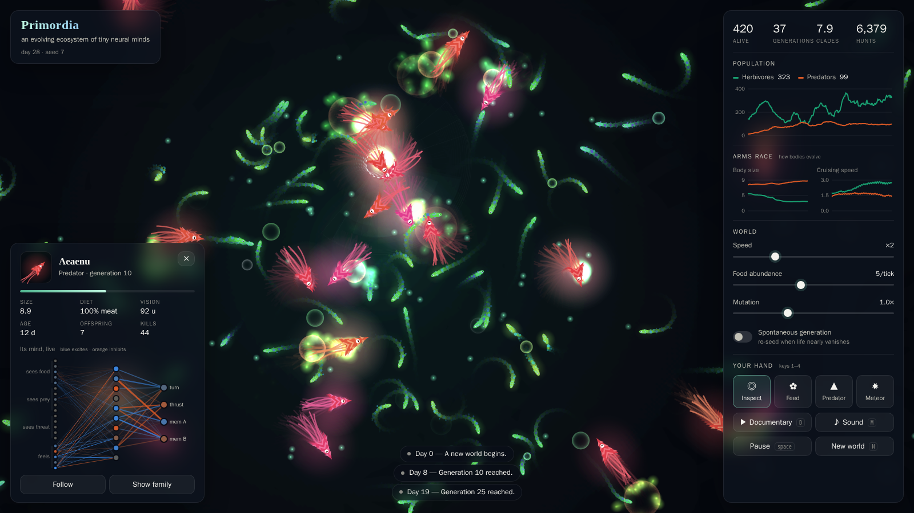

# Primordia

[](https://github.com/clems4ever/primordia/actions/workflows/ci.yml)

An evolving ecosystem of tiny neural minds, in the browser.



Each creature has a small neural network for a brain and a few genes: body size, diet, vision range and colour. It sees food, prey and threats, and it can turn and thrust. That's all. Grazing, fleeing, hunting and the predator–prey arms race all come from mutation and selection. None of it is programmed in.

## Run it

No build step and no dependencies. Serve the folder and open it:

```sh
python3 -m http.server 8765
# open http://localhost:8765
```

Add `?seed=7` for a reproducible world, or `?seed=7&warm=6000` to start from an already-evolved one.

## Play

- **Click a creature** to see its genes and a live view of its brain.
- **1–4** switch tools: inspect, feed, release a predator, drop a meteor.
- **Scroll** to zoom, **drag** to pan, **Space** to pause, **N** for a new world, **H** to hide the interface, **P** for a performance overlay.
- Sliders control speed, food and mutation. **Spontaneous generation** (off by default) re-seeds the world when life nearly vanishes.

## Develop

```sh
npm test            # simulation unit tests (Node 22, no install needed)
npm ci && npx playwright install chromium
npm run test:e2e    # browser tests
npm run bench       # A/B benchmark of sim.js against main
```

`sim.js` is the simulation and has no DOM, so it runs in Node too. `app.js` handles rendering and the interface.

## License

[MIT](LICENSE)
